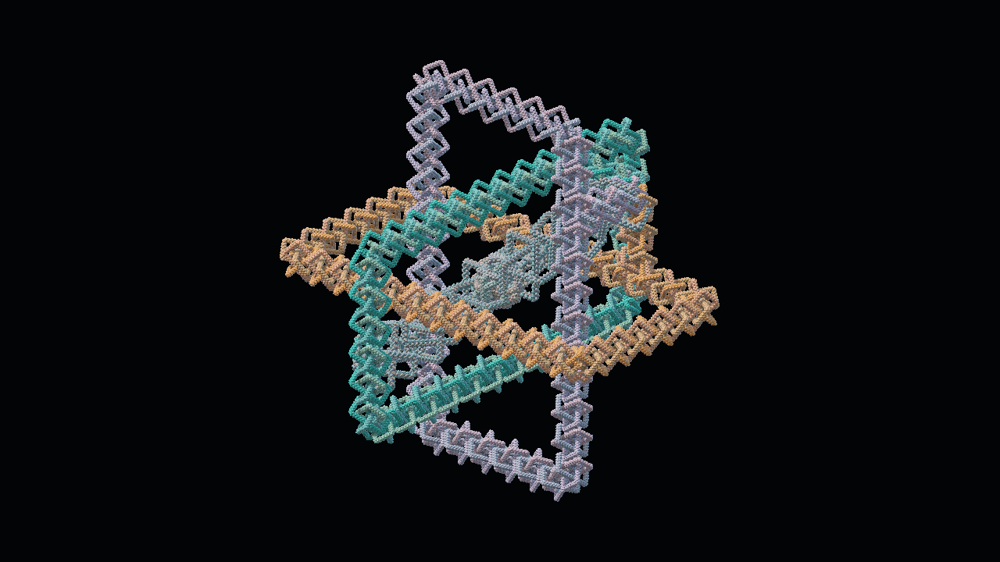

# Rotational Seed Fractals

Connected, exactly self-similar spatial constructions with retained polygonal
links or planar sheets. Every similarity copy contains the whole attractor.
At a dense set of centres, normalized views approach a full ball at every
sufficiently small scale, although the attractors have zero volume.

**Research candidates, not an established new category.** The definitions and
proofs below establish properties of specific constructions. Historical
originality, exact Hausdorff dimensions, and the topology of the complete
attractors remain unresolved. This is an internally checked research draft;
external mathematical review is pending.

[Website](https://okwhynot-wtf.github.io/rotational-seed-fractals/) ·
[Paper draft](research/PAPER_DRAFT.md) ·
[Definitions](docs/definition.md) ·
[Results](docs/results.md) ·
[Literature audit](research/PRIOR_ART.md)



## The constructions

| Construction | Retained structure | Symmetry | Proven dimensional information |
|---|---|---|---|
| Selected linked continuum, m=3, M=6, q=1/8 | Polygonal Borromean triple and connecting segments | C3 | 1 < dim_H < 17/8; dim_A = 3 |
| Thin linked member, m=6, M=6, q=1/8 | Same designated linked skeleton | C3 | 1 < dim_H < 23/12; dim_top = 1; dim_A = 3 |
| Eight-map reference membrane, q=1/4 | A square and its rotated similarity images | C4 | 2 < dim_H < 2.271553252338126; dim_top = 2; dim_A = 3 |
| Separate norm-13 membrane | A square with a different exact rotation | C4 | 2 < dim_H < 2.270907424784688; dim_top = 2; dim_A = 3 |

Here dim_H, dim_top, and dim_A denote Hausdorff, topological, and Assouad
dimension. C3/C4 state guaranteed rotational symmetries, not a classification
of every possible symmetry. The embedded Borromean triple does not classify
the topology of its containing attractor. The larger membrane pictured on the
website is a **12-map anchored variant**, not the eight-map reference in the
dimension table.

The [graph compiler](survey/GRAPH_COMPILER.md) extends the retained-segment
construction to prescribed finite polygonal graphs with a strict dimension
budget. The [overlap study](constructive/overlaps/OVERLAPS.md) supplies exact
affine-word coincidences and improved membrane upper bounds. The proofs and
the limits of these conclusions are in the [paper draft](research/PAPER_DRAFT.md).

The [spectral-gap corollary](research/SPECTRAL_TANGENTS.md), with a
[separate internal review](research/SPECTRAL_TANGENTS_REVIEW.md), strengthens
the full-ball limit to a positive-power rate with an unknown exponent. It
gives ordinary Assouad spectrum three for parameters sufficiently near one
and quasi-Assouad dimension three; the transition threshold is not computed.
A separate [exact finite certificate](constructive/tangent_bounds/README.md)
puts the original eight-map q=1/4 membrane's normalized origin view within
0.009278720270 of the unit ball at **every** scale t ≤ 1/16384. This numerical
bound concerns the reference membrane, not the anchored visual variant.
Neither strengthening establishes historical originality.

## Reproduce and check

Run these commands from the repository root. Python 3.12 is the tested runtime.
The optional `uv` runner creates an isolated environment.

```sh
uv run --python 3.12 --with numpy --with sympy python scripts/verify.py
uv run --python 3.12 --with markdown python scripts/build_site.py
python scripts/check_site.py
python -m http.server 8874 --directory site
```

Alternatively, create a Python environment and install `requirements.txt`.
`verify.py` runs 16 checks in a temporary source copy and writes
`scripts/verification.json`. The suite includes exact scalar inequalities,
polygon-link colourings, rational and symbolic similarity checks, affine-word
equalities, a bounded exact distinct-word screen, and integer verification of
the complete-sphere tangent bounds from saved witnesses. Numerical checks are
identified separately. A passing suite is not a machine-checked proof of every
analytic theorem, a full topology classification, or a novelty certificate.

The site builder reads `docs/` and `research/PAPER_DRAFT.md` and preserves the
computed media in `site/assets/`. `check_site.py` checks local links, fragments,
repository source targets, media presence, and basic image/video labels.
MathJax is loaded from a CDN; the films and images are local assets. GitHub
Pages deployment is defined in [the workflow](.github/workflows/pages.yml).

To generate the selected graph recipes and exact application imports:

```sh
uv run --python 3.12 --with numpy python survey/axis_variants.py
uv run --python 3.12 --with numpy python survey/low_dimension.py
uv run --python 3.12 --with numpy --with sympy python survey/export_aifs.py --m 3 --axis 6 --central 1/8
python constructive/export_exact.py
python constructive/overlaps/export_norm13.py
```

## Films and native applications

- [Linked orbit](site/assets/hero.mp4): 24 seconds, native 1280 × 720.
- [Nested-copy descent](site/assets/descent.mp4): 16 seconds, native 1280 × 720.
- [Anchored membrane orbit](site/assets/membrane-orbit.mp4): 16 seconds, native 1280 × 720.
- [TouchDesigner component and instructions](touchdesigner/README.md): a
  self-contained viewer for three linked candidates, with 200,000 finite
  deterministic point samples per active candidate.
- [IFStile import record](ifstile/IMPORT_CHECK.md): exact AIFS definitions and
  observed native import. This was an import/inspection, not an automated
  IFStile search of attractor space.

The films are generated by `rendering/make_films.py` using ModernGL and FFmpeg.
Reproduction requires a suitable OpenGL context and the dependencies in
`requirements.txt`; cached sampled fields are regenerated locally. The linked
films use a finite display envelope around sampled geometry, refreshed through
actual nested IFS copies during the zoom. Membrane panels are exact contained
square copies truncated at finite depth; they omit a residual part of the
attractor. Neither rendering is a proof of the infinite object, a watertight
mesh, or evidence of nonempty interior. No generative image model produced the
geometry. See [media details](docs/media.md).

## Repository guide

| Directory | Contents |
|---|---|
| `research/` | Manuscript, literature audit, internal review, link proof/checks |
| `survey/` | Linked recipes, graph compiler, comparisons, scalar certificates |
| `constructive/` | Membrane and anchored variants, exact exports, overlap study |
| `rendering/` | Computational image and film renderers and receipts |
| `touchdesigner/` | Portable `.tox`, installer, native previews and validation |
| `ifstile/` | Native import notes |
| `docs/`, `site/` | Website sources, generated pages, computed media |
| `scripts/` | Build, static checks, isolated verification runner |

Code and original parameter/certificate data: [MIT](LICENSE). Original writing,
images, and films: [CC BY 4.0](CONTENT-LICENSE.md). Credit **okwhynot-wtf**;
substantial mathematical, coding, and editorial assistance was provided by
OpenAI GPT models through Codex. Linked publications retain their own terms.
